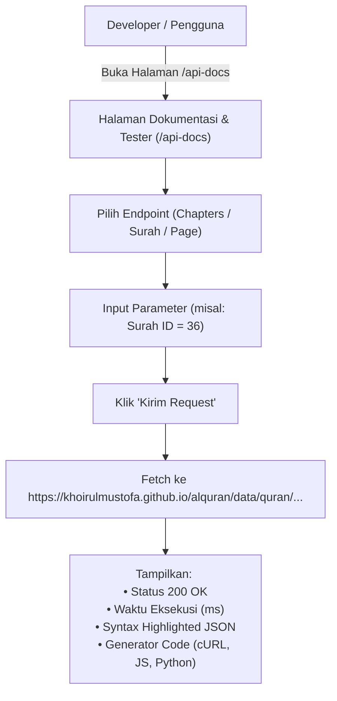

# Implementation Plan: Public Static REST API, Sidebar Menu, and Interactive API Documentation & Tester

Dokumen ini merinci rencana teknis pembuatan **Public REST API** yang disajikan langsung dari domain GitHub Pages (`https://khoirulmustofa.github.io/alquran/`), penambahan **menu navigasi "API & Docs"** di Sidebar, serta pembangunan **halaman dokumentasi dan testing API interaktif** (API Playground / Tester mirip Postman/Swagger).

---

## 1. Goal Description

Menyediakan akses API publik Al-Qur'an gratis dan instan yang dapat digunakan oleh developer lain atau aplikasi pihak ketiga langsung dari `github.io`, lengkap dengan:
1. **Public Static REST API Endpoints**:
   - `GET https://khoirulmustofa.github.io/alquran/data/quran/chapters.json` (Daftar 114 Surah)
   - `GET https://khoirulmustofa.github.io/alquran/data/quran/surah/{id}.json` (Ayat per Surah, id: 1 - 114)
   - `GET https://khoirulmustofa.github.io/alquran/data/quran/page/{page}.json` (Ayat per Halaman, page: 1 - 604)
   - Alias REST v1: `/api/v1/chapters.json`, `/api/v1/surah/{id}.json`, `/api/v1/page/{page}.json`
   - OpenAPI 3.0 specification: `/api/openapi.json`
2. **Menu Sidebar Baru**:
   - Menambahkan menu **"API & Docs"** di [`app/components/AppSidebar.vue`](file:///c:/Users/Zahra/Documents/JS/alquran/app/components/AppSidebar.vue) dengan icon code/terminal dan active indicator.
3. **Halaman Dokumentasi & Playground Interaktif (`/api-docs`)**:
   - Antarmuka modern yang menyatu dengan estetika *Khoirul Mustofa Mengaji*.
   - **Interactive API Tester**: Pengguna/developer dapat memilih endpoint, memasukkan parameter (misal: Surah ID `36` atau Halaman `1`), menekan tombol **"Kirim Request"**, dan melihat respons real-time JSON beserta status HTTP (`200 OK`), response time, dan tombol salin JSON.
   - **Generator Cuplikan Kode**: Menampilkan contoh cara memanggil API dalam bahasa cURL, JavaScript, Python, dan PHP.

---

## 2. User Review Required

> [!NOTE]
> **CORS & Hosting di GitHub Pages:**
> GitHub Pages secara bawaan mendukung **CORS (Cross-Origin Resource Sharing)** dengan header `Access-Control-Allow-Origin: *`. Ini artinya API ini dapat dipanggil langsung dari website/domain lain mana pun tanpa terblokir browser.

> [!TIP]
> **Kecepatan & Ketersediaan 100%:**
> Karena seluruh 114 surah dan 604 halaman disajikan sebagai static JSON di GitHub Pages CDN (Fastly / Cloudflare edge), latensi respons sangat rendah (di bawah 50ms) dan tidak ada batasan kuota rate limit server pribadi.

---

## 3. Arsitektur & Alur Interaksi API Playground



---

## 4. Proposed Changes

### 1. Komponen Navigasi

#### [MODIFY] [app/components/AppSidebar.vue](file:///c:/Users/Zahra/Documents/JS/alquran/app/components/AppSidebar.vue)
- Tambahkan menu link **API & Docs** (`to="/api-docs"`) di dalam grup navigasi `MAIN`.
- Berikan ikon terminal/code (`<svg>` kurung siku kode atau database).
- Tambahkan styling active state saat rute `/api-docs` dibuka.

---

### 2. Halaman Dokumentasi & Tester API

#### [NEW] `app/pages/api-docs.vue`
- Layout multi-kolom yang rapi:
  - **Sidebar Kiri**: Daftar endpoint yang dapat dipilih:
    - `GET /chapters.json` (Semua Surah)
    - `GET /surah/{id}.json` (Detail Surah & Terjemahan)
    - `GET /page/{page}.json` (Detail Halaman Mushaf 1-604)
    - `GET /openapi.json` (OpenAPI Spec)
  - **Main Console**:
    - Header endpoint dengan HTTP Method badge (`GET`), path lengkap, dan tombol salin URL.
    - Parameter form: Input interaktif (contoh: nomor surah dropdown 1-114 atau input halaman 1-604).
    - Tombol aksi: **"Kirim Request"** (dengan animasi loading & waktu eksekusi).
    - Response Panel:
      - Status bar: Badge `200 OK`, response size, response time (ms).
      - Viewer JSON dengan opsi minimize / maximize dan tombol **"Salin JSON"**.
    - Code Snippets Tabs:
      - Tab `cURL`
      - Tab `JavaScript (Fetch)`
      - Tab `Python (requests)`
      - Tab `PHP`

---

### 3. File Alias & Spesifikasi OpenAPI

#### [NEW] `public/api/openapi.json`
- File spesifikasi OpenAPI 3.0 standar yang mendokumentasikan seluruh endpoint publik, skema parameter, dan contoh payload untuk memudahkan import ke Swagger UI atau Postman.

#### [NEW] `scripts/generate-api-aliases.mjs`
- Script pembantu untuk membuat symlink / duplikasi folder `public/api/v1/` yang mengarah ke `public/data/quran/` sehingga developer dapat memanggil URL yang lebih singkat:
  `https://khoirulmustofa.github.io/alquran/api/v1/chapters.json`
  `https://khoirulmustofa.github.io/alquran/api/v1/surah/1.json`

---

### 4. Dokumentasi

#### [MODIFY] [README.md](file:///c:/Users/Zahra/Documents/JS/alquran/README.md)
- Tambahkan seksi **"📡 Public REST API & Dokumentasi"** dengan tabel endpoint resmi, contoh cURL, dan link langsung ke halaman tester `/api-docs`.

---

## 5. Verification Plan

### Automated Verification
- Validasi kompilasi Nuxt static generation:
  ```bash
  cmd /c npm run generate
  ```
- Uji response endpoint publik via curl:
  ```bash
  curl.exe -s http://localhost:3000/data/quran/chapters.json
  curl.exe -s http://localhost:3000/data/quran/surah/36.json
  ```

### Manual Verification
1. Buka `http://localhost:3000/` dan klik menu **"API & Docs"** di Sidebar.
2. Pastikan halaman `/api-docs` terbuka dengan antarmuka yang bersih dan presisi.
3. Coba lakukan testing interaktif:
   - Pilih Surah `36` (Yasin) dan klik "Kirim Request".
   - Verifikasi respons JSON tampil rapi dengan harakat Arab dan terjemahan Indonesia.
   - Uji tombol salin URL dan tombol salin JSON.
   - Uji generator kode JavaScript/cURL.
