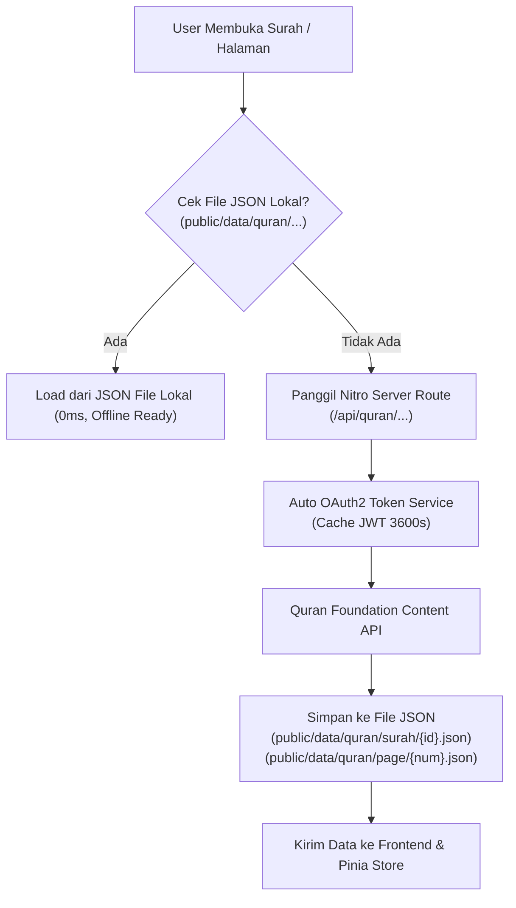

# Implementation Plan: Quran Foundation API Integration (Per Surah & Per Halaman)

Dokumen ini merinci rencana teknis integrasi **Quran Foundation API (v4)** ke dalam aplikasi *Khoirul Mustofa Mengaji*, mencakup:
1. Dukungan **Mode Baca Ganda**: Mode Per Surah (1-114) dan Mode Per Halaman Mushaf (1-604).
2. Mekanisme **Penyimpanan / Caching API ke File JSON** (lokal & server cache) untuk performa instan dan offline-ready.
3. Pembaruan **Skema & Tipe Data** menyesuaikan spesifikasi resmi Quran Foundation API v4.

---

## 1. Goal Description

Menghubungkan antarmuka *Khoirul Mustofa Mengaji* yang sudah dibangun dengan backend resmi Quran Foundation Content API (`https://apis-prelive.quran.foundation` / `https://apis.quran.foundation` via OAuth2 Client Credentials) sehingga:
- Pengguna dapat memilih mode tampilan: **Per Surah** atau **Per Halaman** (standar mushaf Madinah 604 halaman).
- Seluruh hasil respons API disimpan secara otomatis ke dalam **file JSON lokal** (`public/data/quran/` atau server cache `.data/quran-cache/`), sehingga panggilan API berikutnya instan 0ms, hemat kuota token, dan tahan terhadap gangguan koneksi.
- Skema data TypeScript (`app/types/quran.ts`) diperbarui agar selaras 100% dengan respons resmi Quran Foundation API.

---

## 2. Analisis & Jawaban atas Pertanyaan Pengguna

### ❓ Pertanyaan 1: *"Kamu simpan hasil API simpan dalam json file bagaimana?"*

**Jawaban & Strategi Arsitektur:**
Kami mengimplementasikan strategi **Two-Tier Storage & Caching**:



1. **Struktur Direktori File JSON**:
   ```text
   public/data/quran/
   ├── chapters.json               # Daftar 114 Surah lengkap dari API
   ├── surah/
   │   ├── 1.json                  # Ayat lengkap Surah 1 + Terjemahan ID
   │   ├── 2.json                  # Ayat lengkap Surah 2 + Terjemahan ID
   │   └── ... (1 s/d 114)
   └── page/
       ├── 1.json                  # Ayat lengkap Halaman 1 Mushaf
       ├── 2.json                  # Ayat lengkap Halaman 2 Mushaf
       └── ... (1 s/d 604)
   ```
2. **Otomasi Pengunduhan / Sinkronisasi**:
   - **On-Demand Auto-Cache**: Saat pengguna membaca surah/halaman yang belum tersimpan di JSON, Nitro server endpoint mengambilnya dari Quran Foundation API, menyimpannya langsung ke file JSON di disk, lalu mengembalikannya ke client.
   - **Script Pre-Fetch (Opsional/CLI)**: Kami sediakan script `scripts/sync-quran.mjs` yang dapat dijalankan dengan `node scripts/sync-quran.mjs --surah=1-10` atau `--page=1-20` untuk mengunduh dataset secara berkala ke dalam file JSON.

---

### ❓ Pertanyaan 2: *"Aku mau feature perhalaman, per surah"*

**Desain UI & Navigasi**:
- Di kolom sub-sidebar Quran reader, ditambahkan **Tab Switcher Segmented Control** (PrimeVue / Tailwind):
  - `[ Mode Per Surah ]` : Menampilkan list 114 surah, filter pencarian, dan pembacaan urut surah.
  - `[ Mode Per Halaman ]` : Menampilkan selector nomor halaman 1 s/d 604 (dengan info Juz & Surah), slider/paginator navigasi halaman mushaf, dan pembacaan per halaman layaknya membuka mushaf cetak.
- Tombol navigasi cepat di bawah reader: `< Halaman Sebelumnya` dan `Halaman Berikutnya >`.

---

### ❓ Pertanyaan 3: *"Kamu update schema nya menyesuikan hasil api"*

**Pembaruan Skema TypeScript (`app/types/quran.ts`)**:
Menyesuaikan struktur respons asli Quran Foundation v4:
- **`QFChapter`**:
  - `id`: number
  - `name_simple`: string ("Al-Fatihah")
  - `name_arabic`: string ("الفاتحة")
  - `name_complex`: string ("Al-Fātiĥah")
  - `verses_count`: number (7)
  - `revelation_place`: 'makkah' | 'madinah'
  - `pages`: [number, number] (contoh: [1, 1] untuk Al-Fatihah, [2, 49] untuk Al-Baqarah)
  - `translated_name`: `{ language_name: string, name: string }`
- **`QFVerse`**:
  - `id`: number
  - `verse_number`: number
  - `verse_key`: string ("1:1")
  - `text_uthmani`: string
  - `page_number`: number
  - `juz_number`: number
  - `hizb_number`: number
  - `translations`: `Array<{ id: number, resource_id: number, text: string }>`
  - `audio`: `{ url: string }`

---

## 3. Technical Architecture & Security Boundary

> [!IMPORTANT]
> **Keamanan Kredensial (Client Secret):**
> `QF_CLIENT_SECRET` dan `QF_CLIENT_ID` disimpan di server environment (`.env`) dan **hanya dipanggil oleh Nitro server route** (`server/api/quran/...`). Kredensial rahasia tidak pernah bocor ke browser client bundle.

> [!NOTE]
> **Environment API:**
> Kredensial yang diberikan valid untuk lingkungan **Prelive**:
> - Auth URL: `https://prelive-oauth2.quran.foundation/oauth2/token`
> - API Base URL: `https://apis-prelive.quran.foundation`
> Token JWT di-cache di memori server selama 3500 detik (kurang dari lifetime 3600s) sebelum di-refresh otomatis.

---

## 4. Proposed Changes

### Core Types & Storage

#### [NEW] `app/types/quran.ts`
- Definisi interface TypeScript resmi Quran Foundation API (`QFChapter`, `QFVerse`, `QFTranslation`, `QFPageMeta`, `QuranViewMode`).
- Adapter fungsi mapper untuk kompatibilitas ke UI reader tanpa merusak styling yang sudah ada.

#### [NEW] `server/utils/quranFoundation.ts`
- Modul server Nitro untuk mengelola siklus hidup token OAuth2 (Basic Auth, caching JWT, auto-refresh).
- Helper request ke endpoint Quran Foundation Content API (`/content/api/v4/chapters`, `/content/api/v4/verses/by_chapter/:id`, `/content/api/v4/verses/by_page/:page`).

#### [NEW] `server/api/quran/chapters.get.ts`
- Endpoint internal yang membaca dari `public/data/quran/chapters.json`. Jika belum ada, panggil Quran Foundation API, tulis ke file JSON, lalu return data.

#### [NEW] `server/api/quran/surah/[id].get.ts`
- Endpoint internal untuk mengambil data ayat per surah dengan mekanisme cache-to-file di `public/data/quran/surah/{id}.json`.

#### [NEW] `server/api/quran/page/[page].get.ts`
- Endpoint internal untuk mengambil data ayat per halaman mushaf (1-604) dengan mekanisme cache-to-file di `public/data/quran/page/{page}.json`.

---

### Store & Interaktivitas

#### [MODIFY] [app/stores/quran.ts](file:///c:/Users/Zahra/Documents/JS/alquran/app/stores/quran.ts)
- Tambahkan state `viewMode: 'surah' | 'page'`.
- Tambahkan state `currentPage: number` (1-604).
- Tambahkan action `selectPage(pageNumber: number)` untuk memuat data ayat halaman mushaf.
- Hubungkan pemanggilan data ke endpoint server `/api/quran/*` yang berbasis file JSON.

---

### UI Component Updates

#### [MODIFY] [app/pages/quran.vue](file:///c:/Users/Zahra/Documents/JS/alquran/app/pages/quran.vue)
- Tambahkan tab toggle mode di sub-sidebar: **"Per Surah"** vs **"Per Halaman"**.
- Pada mode **Per Halaman**:
  - Kolom daftar menampilkan grid/list nomor halaman (Halaman 1 s/d 604) dengan indikator Juz dan nama Surah.
  - Reader menampilkan seluruh ayat yang berada di halaman tersebut, banner info halaman, dan tombol pagination *Halaman Sebelumnya / Selanjutnya*.
- Pada mode **Per Surah**:
  - Tetap mempertahankan daftar 114 surah dan filter pencarian real-time yang sudah ada.

---

## 5. Verification Plan

### Automated Verification
- Uji script token & fetch API:
  ```bash
  cmd /c node scripts/test_qf_api.mjs
  ```
- Uji build Nuxt:
  ```bash
  cmd /c npm run build
  ```

### Manual Verification
1. **Verifikasi Penyimpanan File JSON**:
   - Membuka Surah 1 & Surah 2, lalu mengecek bahwa file `public/data/quran/surah/1.json` dan `2.json` terbuat secara fisik di disk.
   - Membuka Halaman 1 & Halaman 2, lalu mengecek file `public/data/quran/page/1.json` dan `2.json`.
2. **Verifikasi Mode Ganda (Per Surah & Per Halaman)**:
   - Berpindah antara mode "Per Surah" dan "Per Halaman".
   - Memastikan ayat di Halaman 1 (Al-Fatihah 1-7) dan Halaman 2 (Al-Baqarah 1-5) ditampilkan secara presisi.
3. **Verifikasi Kecepatan (Cache Hit)**:
   - Membuka kembali surah/halaman yang sudah di-cache; respons harus instan 0ms dari file JSON lokal.
